# Class Activity 1 — System Calls in Practice

- **Student Name:** [SUN Ousaphea]
- **Student ID:** [e20230369]
- **Date:** [10/11/2026]

---

## Warm-Up: Hello System Call

Screenshot of running `hello_syscall.c` on Linux:

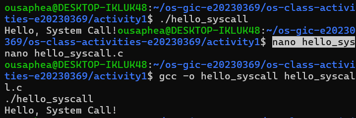

Screenshot of running `hello_winapi.c` on Windows (CMD/PowerShell/VS Code):

Screenshot of running `copyfilesyscall.c` on Linux:

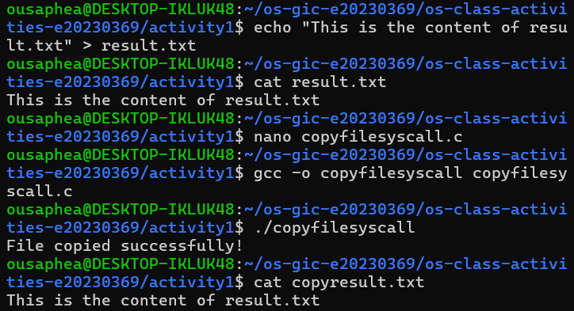

---

## Task 1: File Creator & Reader

### Part A — File Creator

**Describe your implementation:**

The library version uses `fopen()` to create and open the file, `fprintf()` to write the text, and `fclose()` to close the file. The system call version uses `open()` to create the file, `write()` to write the text, and `close()` to close it. Both programs create a file containing the same message. However, the system call version requires more manual control over file operations, while the library version provides simpler functions.

**Version A — Library Functions (`file_creator_lib.c`):**

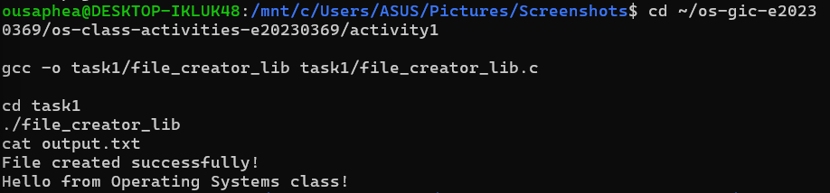

**Version B — POSIX System Calls (`file_creator_sys.c`):**

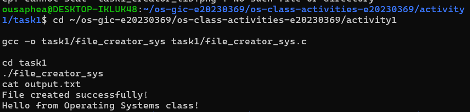

**Questions:**

1. **What flags did you pass to `open()`? What does each flag mean?**

   > I used `O_WRONLY | O_CREAT | O_TRUNC`. `O_WRONLY` opens the file for writing only. `O_CREAT` creates the file if it does not exist. `O_TRUNC` removes the existing contents if the file already exists.

2. **What is `0644`? What does each digit represent?**

   > `0644` is the file permission mode passed to `open()`. The first digit, `0`, represents the special permission bits. The second digit, `6`, gives the owner read and write permissions. The third digit, `4`, gives the group read permission. The last digit, `4`, gives other users read permission.

3. **What does `fopen("output.txt", "w")` do internally that you had to do manually?**

   > `fopen()` opens the file for writing and creates it if it does not exist. If the file already exists, it truncates its contents. It also creates a file stream for handling input and output. In the system call version, I had to perform these operations manually using `open()`, `write()`, and `close()`.

### Part B — File Reader & Display

**Describe your implementation:**

The library version uses `fopen()` to open the file in read mode and `fgets()` to read its contents line by line. The system call version uses `open()` to open the file and `read()` to retrieve its contents into a buffer. It then uses `write()` to display the contents in the terminal. Both versions continue reading until the end of the file is reached.

**Version A — Library Functions (`file_reader_lib.c`):**

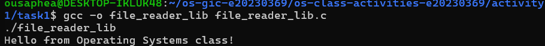

**Version B — POSIX System Calls (`file_reader_sys.c`):**

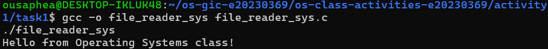

**Questions:**

1. **What does `read()` return? How is this different from `fgets()`?**

   > `read()` returns the number of bytes successfully read. It returns `0` when the end of the file is reached and `-1` if an error occurs. In comparison, `fgets()` reads a line or a specified number of characters into a string and returns a pointer to the buffer when successful. It returns `NULL` when it reaches the end of the file or an error occurs.

2. **Why do you need a loop when using `read()`? When does it stop?**

   > A loop is needed because `read()` may not retrieve all the requested data in one call. The program continues reading while `read()` returns a positive number of bytes. It stops when `read()` returns `0`, indicating the end of the file, or when it returns `-1`, indicating an error.

---

## Task 2: Directory Listing & File Info

**Describe your implementation:**

Both versions use opendir() to open the current directory and readdir() to retrieve directory entries. They use stat() to obtain file information, including file size. The library version uses printf() to display the filenames and their sizes. The system-call version uses snprintf() to format the output into a buffer and write() to display it in the terminal. Both versions use closedir() to close the directory after listing its contents.

### Version A — Library Functions (`dir_list_lib.c`)

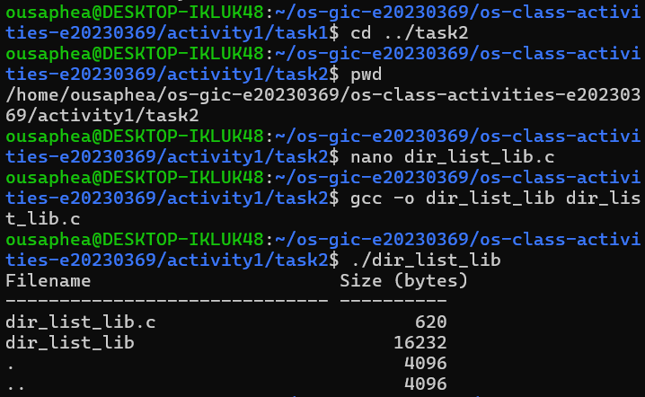

### Version B — System Calls (`dir_list_sys.c`)

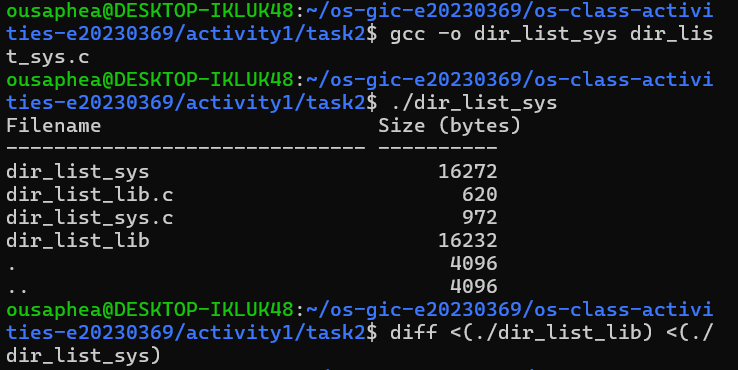

### Questions

1. **What struct does `readdir()` return? What fields does it contain?**

   > `readdir()` returns a pointer to a `struct dirent`, which represents a directory entry. Important fields include `d_name`, the entry's name, `d_ino`, which contains the inode number, and d_type, which indicates the entry type where supported.

2. **What information does `stat()` provide beyond file size?**

   > `stat()` provides information such as file type, permissions, inode number, number of hard links, owner ID, group ID, and the last access, modification, and status-change times.

3. **Why can't you `write()` a number directly — why do you need `snprintf()` first?**

   > `write()` expects a buffer containing bytes. A number is stored as a numeric value, not as its readable character representation. `snprintf()` converts the file size into formatted text and stores it in a character buffer,which can then be passed to `write()`.

---

## Optional Bonus: Windows API (`file_creator_win.c`)

Screenshot of running on Windows:

### Bonus Questions

1. **Why does Windows use `HANDLE` instead of integer file descriptors?**

   > Windows uses `HANDLE` as a general reference to operating system objects, such as files and processes. It provides a way for Windows APIs to identify and manage these resources.

2. **What is the Windows equivalent of POSIX `fork()`? Why is it different?**

   > Windows commonly uses `CreateProcess()` to create a new process. Unlike POSIX `fork()`, which creates a child process by duplicating the calling process, `CreateProcess()` creates a new process by loading a specified executable program.

3. **Can you use POSIX calls on Windows?**

   > Standard POSIX calls are not directly supported by the Windows API. However, they can be used through compatibility environments such as WSL, Cygwin, or MSYS2.

---

## Task 3: strace Analysis

**Describe what you observed:**

Using `strace`, I could observe the system calls made by each program. The library version made 38 system calls, while the system call version made 34 in the recorded comparison. This means the library version made 4 more system calls in that run. I also noticed that library functions can generate additional system calls internally, even when the source code looks simpler.

### strace Output — Library Version (File Creator)

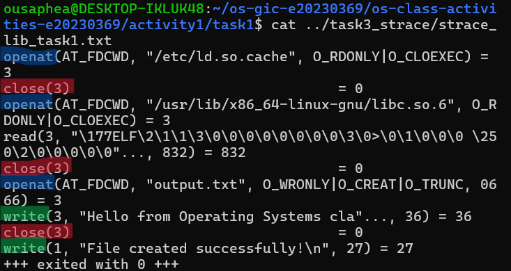

**Annotation:**

- **Blue — `openat()`:** Opens or creates the output file.
- **Green — `write()`:** Writes the file contents and displays the success message in the terminal.
- **Red — `close()`:** Closes the file descriptor after writing is complete.

### strace Output — System Call Version (File Creator)

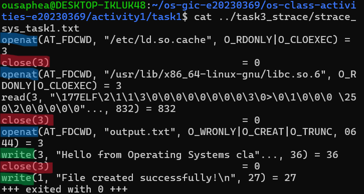

**Annotation:**

- **Blue — `openat()`:** Opens or creates the output file.
- **Green — `write()`:** Writes data to the file and displays the confirmation message.
- **Red — `close()`:** Closes the file descriptor after the operation is complete.

### strace Output — Library Version (File Reader or Dir Listing)

**Annotation:**

- **Blue — `openat()`:** Opens the file for reading.
- **Yellow — `read()`:** Reads the file contents. The first read successfully retrieves 36 bytes, and the next read returns 0, indicating the end of the file.
- **Green — `write()`:** Displays the contents in the terminal.
- **Red — `close()`:** Closes the file descriptor.

### strace Output — System Call Version (File Reader or Dir Listing)

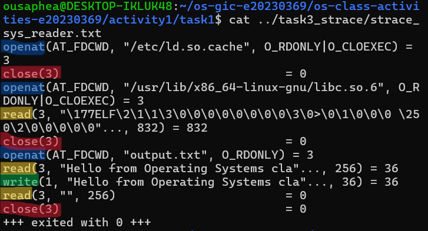

**Annotation:**

- **Blue — `openat()`:** Opens the file for reading.
- **Yellow — `read()`:** Requests 256 bytes and successfully receives 36 bytes. A subsequent read returns 0, indicating the end of the file.
- **Green — `write()`:** Displays the retrieved contents.
- **Red — `close()`:** Closes the file descriptor.

### strace -c Summary Comparison

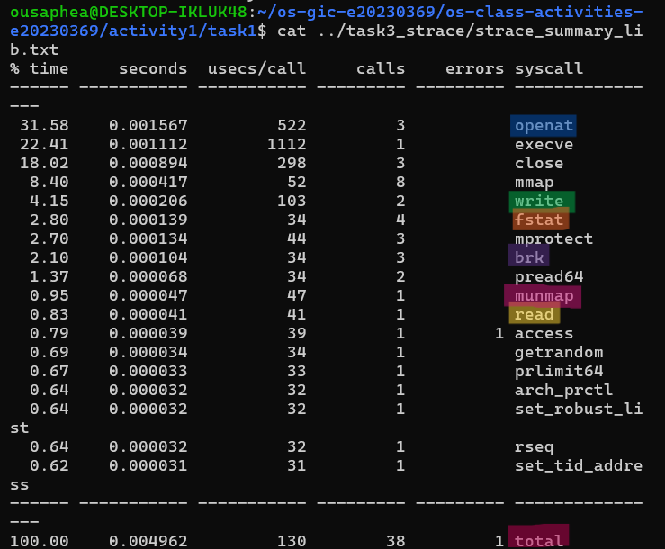

**Annotation:**

- **Orange — `fstat()`:** Retrieves information about an opened file.
- **Purple — `brk()`:** Adjusts the process's heap memory.
- **Pink — `munmap()` and total calls:** `munmap()` removes a memory mapping. The total number of system calls is 38.

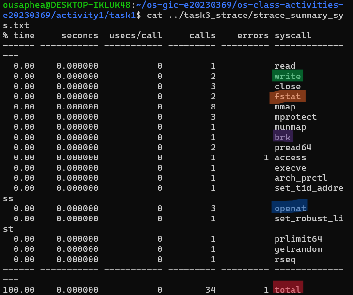

**Annotation:**

- The total number of system calls is 34.
- Both versions show one `munmap()` call.
- The system call version made 4 fewer system calls in this recorded comparison.

### Questions

1. **How many system calls does the library version make compared to the system call version?**

   > The library version made 38 system calls, while the system call version made 34 system calls. Therefore, the library version made 4 more system calls in this comparison.

2. **What extra system calls appear in the library version? What do they do?**

   > The library version made more calls to `fstat()` and `brk()`. `fstat()` retrieves information about an opened file, while `brk()` manages the process's heap memory. These additional calls show that library functions and runtime operations may perform extra work internally. Both versions also made one `munmap()` call, which removes a memory mapping.

3. **How many `write()` calls does `fprintf()` actually produce?**

   > In the recorded trace, `fprintf()` produced one `write()` call to write the file contents. Another `write()` call was used by `printf()` to display the success message in the terminal.

4. **In your own words, what is the real difference between a library function and a system call?**

   > A library function provides a convenient, higher-level way to perform operations in a program. A system call allows a program to request services from the operating system kernel. Library functions can use system calls internally, while system calls provide the interface to kernel services.

---

## Task 4: Exploring OS Structure

### System Information

> 📸 Screenshot of `uname -a`, `/proc/cpuinfo`, `/proc/meminfo`, `/proc/version`, `/proc/uptime`:

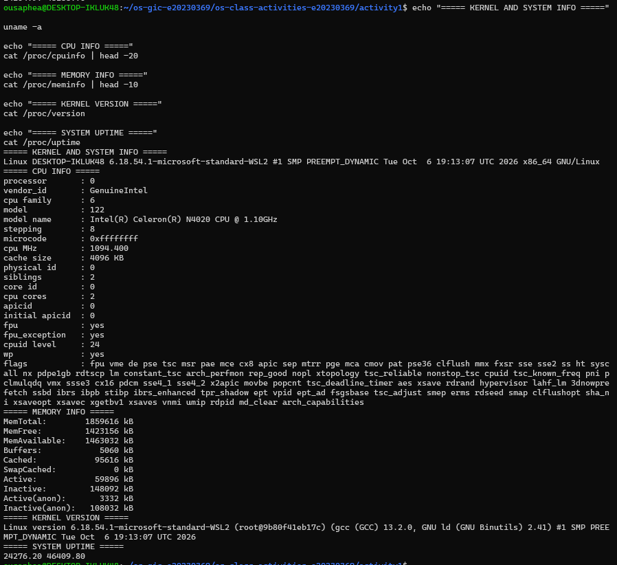

### Process Information

> 📸 Screenshot of `/proc/self/status`, `/proc/self/maps`, `ps aux`:

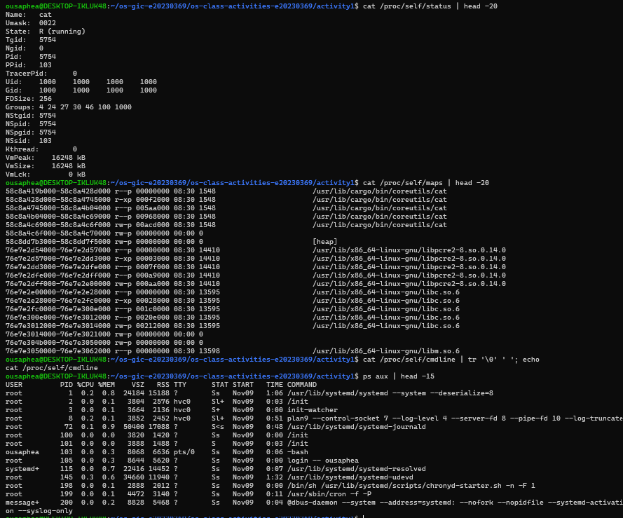

### Kernel Modules

> 📸 Screenshot of `lsmod` and `modinfo`:

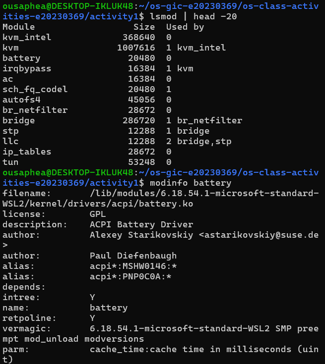

### OS Layers Diagram

> 📸 Your diagram of the OS layers, labeled with real data from your system:

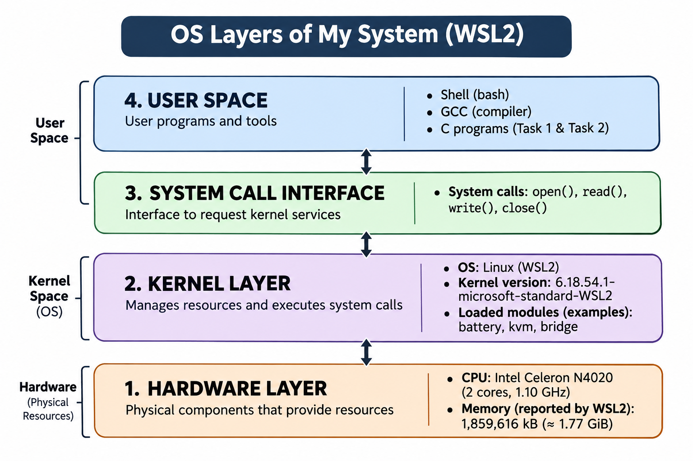

### Questions

1. **What is `/proc`? Is it a real filesystem on disk?**

   > `/proc` is a virtual filesystem provided by the Linux kernel. It is not a normal filesystem stored on a disk. Instead, it provides information about system resources, processes, memory, and kernel details.

2. **Monolithic kernel vs. microkernel — which type does Linux use?**

   > Linux uses a monolithic kernel. Its main operating system services run in kernel space. It also supports loadable kernel modules, which allow additional functionality to be added without rebuilding the entire kernel.

3. **What memory regions do you see in `/proc/self/maps`?**

   > The memory mappings include the program's executable file, heap, shared libraries such as `libc.so.6` and `libm.so.6`, and other memory regions. These mappings show how a process uses different areas of virtual memory.

4. **Break down the kernel version string from `uname -a`.**

   > My kernel version is `6.18.54.1-microsoft-standard-WSL2`. The version numbers are 6.18.54.1, and microsoft-standard-WSL2 identifies the Microsoft WSL2 kernel build. The output also shows that my system architecture is x86_64.

5. **How does `/proc` show that the OS is an intermediary between programs and hardware?**

   > `/proc` provides information about hardware and system resources through the Linux kernel. Programs and users can access information such as CPU, memory, and process details without directly communicating with the hardware. This demonstrates how the operating system manages resources and provides an interface between applications and hardware.

---

## Reflection

Through this activity, I learned how programs interact with the operating system through system calls. I also understood the difference between using library functions and directly using POSIX system calls. Library functions make programming easier by handling some operations internally, while system calls allow programs to request services directly from the kernel.

The most interesting part was using `strace` to observe the system calls made by different programs. It helped me understand that even simple library functions can involve several system-level operations. I also learned how Linux manages files, directories, processes, memory, and kernel modules through the `/proc` filesystem and other system utilities.
