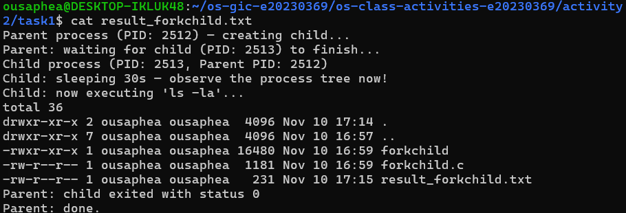
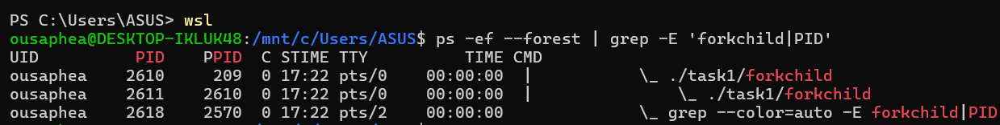
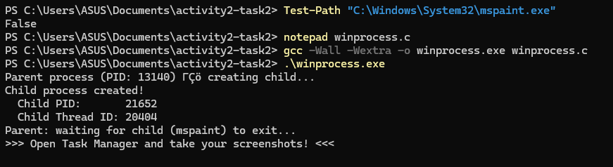
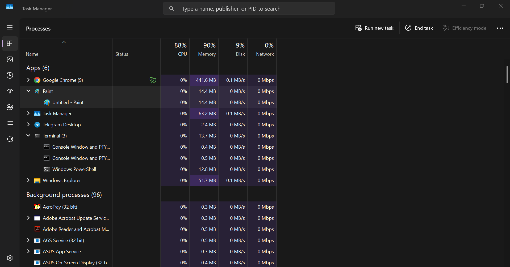
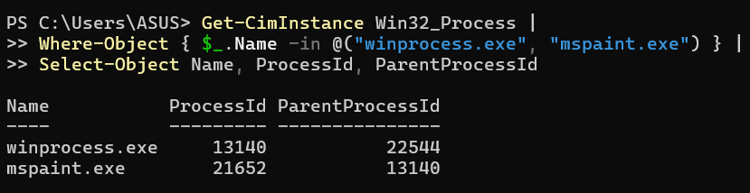
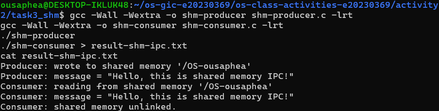
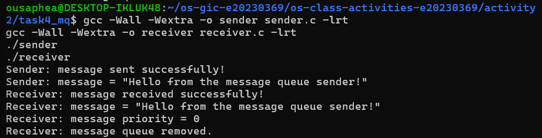

# Class Activity 2 – Processes & Inter-Process Communication

- **Student Name:** SUN Ousaphea
- **Student ID:** e20230369
- **Date:** 10/11/2026

---

## Task 1 – Process Creation using fork() and exec()

### Implementation

Created `forkchild.c` to demonstrate Linux process creation using `fork()` and `execlp()`.

The program creates a child process. The child displays its PID and parent PID, sleeps for 30 seconds, and then executes `ls -la` using `execlp()`. Meanwhile, the parent waits for the child to finish using `waitpid()`.

### Screenshots

**Program compilation and execution**



**Parent-child process tree**



### Questions and Answers

1. **What does `fork()` return to the parent? What does it return to the child?**

   `fork()` returns the child's PID to the parent process, `0` to the child process, and `-1` if an error occurs.

2. **What happens if you remove the `waitpid()` call? Why might the output look different?**

   Without `waitpid()`, the parent does not wait for the child to finish. The parent may print its final message before the child completes, so the output order can be different. The child may also become an orphan or briefly remain a zombie, depending on which process finishes first.

3. **What does `execlp()` do? Why don't we see "execlp failed" when it succeeds?**

   `execlp()` replaces the current process with a new program. In our program, it replaces the child process with `ls -la`. It does not return when successful because the child starts executing the new program. The error message is only printed if `execlp()` fails.

4. **Draw the process tree for your program (parent → child). Include PIDs from your output.**

   ```text
   forkchild (PID: 2610)
   └── forkchild (PID: 2611)
   ```

5. **Which command did you use to view the process tree? What information does each column show?**

   I used `ps -ef --forest | grep -E 'forkchild|PID'`. The UID column shows the process owner, PID shows the process ID, PPID shows the parent process ID, C shows CPU usage, STIME shows the start time, TTY shows the terminal, TIME shows CPU time used, and CMD shows the command being executed.

---

## Task 2 – Process Creation using CreateProcess()

### Implementation

Created `winprocess.c` on Windows using the Windows API function `CreateProcess()`.

The program creates a child process that launches Microsoft Paint (`mspaint.exe`). It displays the parent PID, child PID, and child thread ID. The parent waits for the child to exit using `WaitForSingleObject()` and releases the process and thread handles using `CloseHandle()`.

### Screenshots

**Program compilation and execution**



**Task Manager Processes tab**



**Process IDs and parent-child relationship**



*Note: The Parent PID column was unavailable in my Windows Task Manager version. I used PowerShell's `Get-CimInstance Win32_Process` to verify the process IDs and parent-child relationship.*

### Questions and Answers

1. **What is the key difference between how Linux creates a process (`fork` + `exec`) and how Windows does it (`CreateProcess`)?**

   Linux uses `fork()` to create a child process and `exec()` to replace the child with a new program. Windows uses `CreateProcess()` to create a new process and load the specified program in one call.

2. **What does `WaitForSingleObject()` do? What is its Linux equivalent?**

   `WaitForSingleObject()` makes the parent process wait until the specified child process finishes. Its Linux equivalent is `wait()` or `waitpid()`.

3. **Why do we need to call `CloseHandle()` at the end? What happens if we don't?**

   `CloseHandle()` releases the process and thread handles after they are no longer needed. Without it, the handles remain open and consume system resources.

4. **In Task Manager, what was the PID of your parent program and the PID of mspaint? Do they match your program's output?**

   The parent program `winprocess.exe` had PID **13140**, and `mspaint.exe` had PID **21652**. These match the program's output. PowerShell also confirmed that the Parent PID of `mspaint.exe` was 13140.

5. **Compare the Processes tab and Details tab. Which view makes it easier to understand the parent-child relationship? Why?**

   The Processes tab makes the relationship easier to understand visually because child applications appear nested under their parent group. The Details tab provides more precise process information through PID and Parent PID values. On my Windows version, the Parent PID column was unavailable in Task Manager, so I used PowerShell to verify the relationship.

---

## Task 3 – Shared Memory IPC

### Implementation

Created two programs:

- `shm-producer.c` creates a POSIX shared memory object using `shm_open()`, sets its size using `ftruncate()`, and maps it into memory using `mmap()`. It then writes a message into the shared memory.
- `shm-consumer.c` opens the same shared memory object, maps it into its address space, reads the message, and removes the shared memory object using `shm_unlink()`.

Both programs use the same shared memory name: `/OS-ousaphea`.

### Screenshots

**Compilation and execution**



### Questions and Answers

1. **What does `shm_open()` do? How is it different from `open()`?**

   `shm_open()` creates or opens a POSIX shared memory object that can be accessed by multiple processes. Unlike `open()`, which normally opens a regular file, `shm_open()` is specifically used for shared memory objects.

2. **What does `mmap()` do? Why is shared memory faster than other IPC methods?**

   `mmap()` maps the shared memory object into a process's address space so the process can access it through a pointer. Shared memory is faster because processes can access the same memory region directly without repeatedly copying messages between them.

3. **Why must the shared memory name match between producer and consumer?**

   Both processes must use the same name to access the same shared memory object. If their names are different, the consumer cannot open the memory object created by the producer.

4. **What does `shm_unlink()` do? What would happen if the consumer didn't call it?**

   `shm_unlink()` removes the shared memory object's name. If it is not called, the object can remain available in the system and occupy resources until it is removed.

5. **If the consumer runs before the producer, what happens?**

   If the consumer runs before the producer, `shm_open()` fails because the shared memory object does not exist yet. The program displays an error such as `shm_open: No such file or directory`.

---

## Task 4 – Message Queue IPC

### Implementation

Created two programs using POSIX message queues:

- `sender.c` creates or opens a message queue using `mq_open()` and sends a message using `mq_send()`.
- `receiver.c` opens the queue, receives the message using `mq_receive()`, and removes the queue using `mq_unlink()`.

The queue name and maximum message size are defined in `common.h`.

### Screenshots

**Compilation and execution**



### Questions and Answers

1. **What is the difference between a message queue and shared memory?**

   A message queue allows processes to communicate by sending and receiving messages through a queue managed by the operating system. Shared memory allows processes to communicate by accessing the same memory region directly.

2. **What does `mq_send()` do? What does `mq_receive()` do?**

   `mq_send()` sends a message to a message queue. `mq_receive()` retrieves a message from the queue and can also return its priority.

3. **What is message priority? How would you use it?**

   Message priority determines the order in which messages are received. Messages with higher priority are received before messages with lower priority.

4. **What happens if you call `mq_receive()` on an empty queue? Does it block or return immediately?**

   By default, `mq_receive()` blocks until a message becomes available in the queue. It can return immediately with an error if the queue is configured for non-blocking operation.

5. **Compare the complexity of implementing shared memory IPC vs message queue IPC. Which was easier?**

   Message queues were easier to implement because the operating system handles message storage and transfer. Shared memory required mapping memory into each process's address space and managing access to the shared region.

---

## Reflection

Through this activity, I learned how processes are created and managed in Linux and Windows. I understood how `fork()` and `exec()` work in Linux and how Windows uses `CreateProcess()` to create a child process.

I also learned about inter-process communication using shared memory and message queues. Shared memory allows processes to access the same memory region, while message queues allow them to exchange messages through the operating system.

The most interesting part was observing the parent-child process relationship and verifying process IDs. I also learned the importance of waiting for child processes and releasing resources after communication is completed.

Overall, this activity helped me understand how operating systems manage processes and how different processes communicate with each other.
