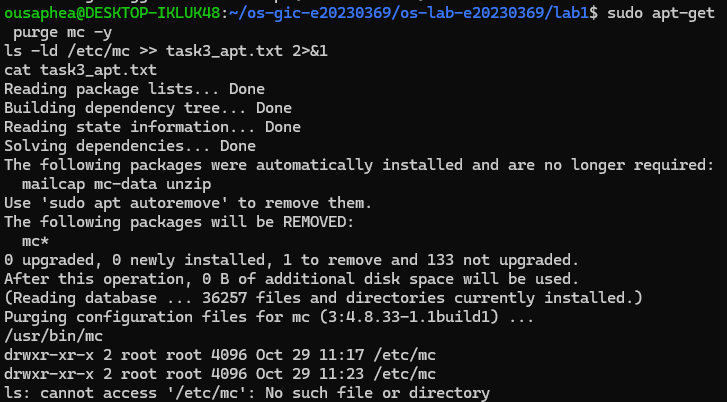
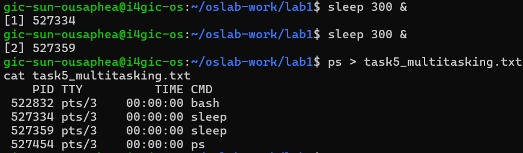
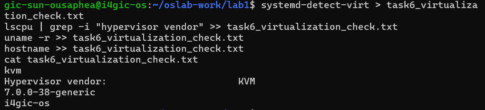

# OS Lab 1 Submission

- **Student Name:** [SUN Ousaphea]
- **Student ID:** e20230369
- **Ubuntu username on the server:** gic-sun-ousaphea
- **My values** (`oslab values lab1`): file1 = ocean, file2 = bridge, count = 2

---

## Task 1: Operating System Identification

My system is running Ubuntu 26.04.1 LTS with the codename `resolute`. The kernel version is `7.0.0-38-generic`, while the distribution version is `26.04`.

The kernel version identifies the Linux kernel running the system, whereas the distribution version identifies the Ubuntu release.

---

## Task 2: Essential Linux File and Directory Commands

I practised creating, copying, renaming and deleting files using Linux commands.

The final directory listing showed the following files:

- `bridge_renamed.txt`
- `ocean.txt`
- `ocean_copy.txt`

This exercise helped me understand how to manage files and directories using the Linux terminal.

---

## Task 3: Package Management Using APT

I used APT to install Midnight Commander (`mc`) and checked its executable path and configuration directory.

After running `apt-get remove`, the program was uninstalled, but its configuration directory `/etc/mc` remained.

After running `apt-get purge`, the configuration directory was also deleted.

This demonstrated that `remove` uninstalls the program while keeping its system configuration, whereas `purge` removes both the program and its system configuration files.

---

## Task 4: Programs vs Processes

A program is a set of instructions stored in a file, while a process is a program that is currently running.

I started a `sleep` command as a background process and used the `ps` command to check the running processes.

The process list showed the `sleep` process running alongside the Bash shell. This helped me understand the difference between a stored program and an executing process.

---

## Task 5: Multitasking

The `ps` command showed two `sleep` processes running at the same time.

This demonstrates that the operating system can manage multiple processes simultaneously. However, the process list does not show exactly how the CPU schedules or shares its processing time between those processes.

---

## Task 6: Virtualization and Hypervisor Detection

The command outputs identified KVM as the hypervisor vendor.

This indicates that the system is running inside a virtual machine rather than directly on physical hardware.

The detected kernel version was `7.0.0-38-generic`, and the hostname was `i4gic-os`.

---

## My Prediction: Confirmed or Corrected

I could not retrieve my previously saved prediction answers.

---

## Plus / Challenge

Not completed.

---

## AI Note (optional)

I used an AI tool to help understand Linux commands and the difference between removing and purging software. I checked the explanations by running the commands and observing the actual results in Ubuntu.